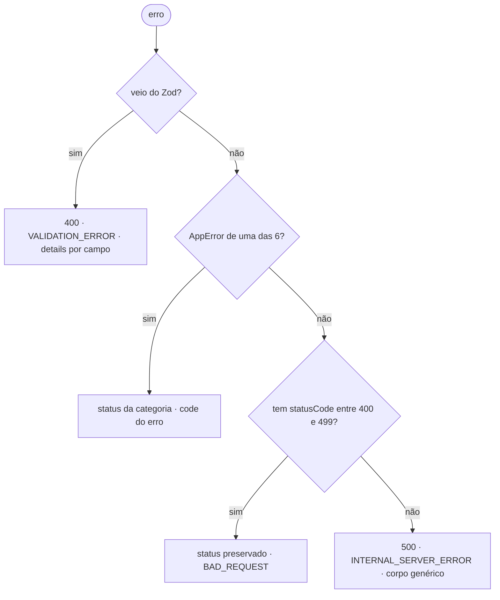

# Erros

Taxonomia semântica na camada pura, um único tradutor para HTTP. O use case
lança, o endpoint não trata, o handler responde.

> **Aqui está como usar.** O porquê de cada escolha está no
> [`ARCHITECTURE.md`](../../../ARCHITECTURE.md) §8.

---

## Os arquivos

| arquivo | camada | faz |
|---|---|---|
| [`app-error.ts`](./app-error.ts) | pura | `AppError` + as 6 categorias abstratas |
| `src/modules/<m>/errors/*.ts` | pura | os erros concretos do módulo |
| [`error-handler.ts`](../../infra/http/errors/error-handler.ts) | infra | traduz erro → status + corpo |
| [`error-response.ts`](../../infra/http/errors/error-response.ts) | infra | schema Zod do corpo de erro |
| [`validation-issues.ts`](../../infra/http/errors/validation-issues.ts) | infra | issue do Zod → `code` do contrato |

Erro concreto mora onde é lançado: erro de domínio em
`src/modules/<m>/errors/`; erro de uma peça de infra compartilhada, no próprio
arquivo dela — `InvalidAccessTokenError` é declarado dentro de
[`auth-guard.ts`](../../infra/http/auth-guard.ts), porque quem o lança é o guard,
e não um módulo. `src/shared/errors/` guarda só as categorias abstratas: erro
concreto nenhum entra aqui.

---

## Como usar

**1. Crie o erro no seu módulo**

```ts
// src/modules/auth/errors/invalid-credentials-error.ts
import { UnauthorizedError } from '#shared/errors/app-error'

const INVALID_CREDENTIALS_CODE = 'INVALID_CREDENTIALS'
const INVALID_CREDENTIALS_MESSAGE = 'Invalid credentials'

export class InvalidCredentialsError extends UnauthorizedError {
  readonly code = INVALID_CREDENTIALS_CODE

  constructor() {
    super(INVALID_CREDENTIALS_MESSAGE)
  }
}
```

O `code` é escrito à mão, nunca derivado do nome da classe: renomear a classe não
pode mudar o contrato público. O literal fica numa constante nomeada como todo
literal do projeto, e a mensagem é em inglês (`CLAUDE.md`).

**2. Lance no use case**

```ts
if (!user) throw new InvalidCredentialsError()
```

**3. Não trate no endpoint**

```ts
async (request, reply) => {
  const { accessToken } = await container.loginUser.execute(request.body)

  return reply.status(OK_STATUS).send({ accessToken })
}
```

Sai `401` com `{"error":{"code":"INVALID_CREDENTIALS", ...}}`: nenhum
`try/catch`, nenhum status de falha decidido aqui.

**4. Declare o status no schema da rota**

```ts
response: {
  [OK_STATUS]: okSchema,
  [BAD_REQUEST_STATUS]: errorResponseSchema,   // validação do Zod
  [UNAUTHORIZED_STATUS]: errorResponseSchema,  // InvalidCredentialsError
},
```

É a única linha de HTTP que o erro custa, e ela não é opcional: não tratar não é
o mesmo que não documentar. O OpenAPI é o contrato de onde o cliente gera código,
e o recorte é o que **aquela rota** produz — o `500` do handler genérico e o `415`
de content-type são universais e não se repetem em todo arquivo
([`ARCHITECTURE.md`](../../../ARCHITECTURE.md) §7).

---

## Qual categoria escolher

A pergunta é "que tipo de falha é esta", não "que status eu quero". O status vem
junto.

| categoria | use quando | status |
|---|---|---|
| `NotFoundError` | o recurso pedido não existe | `404` |
| `ConflictError` | o estado atual colide com a operação | `409` |
| `UnauthorizedError` | não autenticado, ou credencial inválida | `401` |
| `ForbiddenError` | autenticado, mas sem permissão | `403` |
| `ValidationError` | o **valor** é inválido pela regra de domínio | `400` |
| `BusinessRuleError` | o valor é válido, a **operação** não é permitida | `422` |

As duas confusões comuns:

- **`401` vs `403`** — se o usuário logar de novo e o erro sumir, é `401`; se
  continuar, é `403`.
- **`Validation` vs `BusinessRule`** — `"abc"` não é um CPF: `ValidationError`.
  Saldo `R$ 10` é válido, sacar `R$ 50` dele não é: `BusinessRuleError`.

`ValidationError` é validação de **domínio**, lançada por value object ou use
case. Payload inválido no corpo da requisição é pego pelo Zod antes do seu código
rodar e tem ramo próprio.

---

## Comportamento do handler



- **A ordem é carregada de significado.** Erro de validação do Fastify carrega
  `statusCode: 400`; se o ramo do 4xx viesse antes, engoliria o `details[]`.
- **O ramo do 500 não vaza nada** — mensagem fixa, sem stack e sem texto de
  driver. O erro completo vai para o log, correlacionado pelo `traceId`.
- **`AppError` fora das seis categorias cai no 500**, de propósito: é erro de
  programação, não problema do cliente.
- **Rota inexistente** responde `404 ROUTE_NOT_FOUND`, no mesmo formato.

---

## A resposta

```jsonc
{
  "error": {
    "code": "INVALID_CREDENTIALS",
    "message": "Invalid credentials",
    "traceId": "6eedbea3-43fd-4f2a-a41b-3a39336b0268"
  }
}
```

```jsonc
// validação ganha detalhe por campo
{
  "error": {
    "code": "VALIDATION_ERROR",
    "message": "Invalid payload",
    "details": [
      { "field": "email",    "code": "INVALID_FORMAT" },
      { "field": "password", "code": "TOO_SMALL" }
    ],
    "traceId": "6eedbea3-43fd-4f2a-a41b-3a39336b0268"
  }
}
```

- **`code` é contrato**, estável, e serve de chave de i18n no cliente.
- **`message` não é contrato** — é para log e debug, e não deve ser exibida crua
  num app traduzido.
- **`traceId`** é o mesmo valor da linha de log daquela requisição.
- `field` é omitido quando o problema é o corpo inteiro, não um campo.

---

## Regras

| ✅ | ❌ |
|---|---|
| `throw new InvalidCredentialsError()` | `return { error: 'invalid' }` |
| `readonly code = INVALID_CREDENTIALS_CODE` | `readonly code = 'INVALID_CREDENTIALS'` |
| constante escrita à mão | `code` derivado do nome da classe |
| estender uma das seis categorias | estender `AppError` direto |
| erro concreto onde ele é lançado | erro concreto novo em `src/shared/errors/` |
| endpoint sem `try/catch` | `try/catch` traduzindo erro para status |
| `[UNAUTHORIZED_STATUS]: errorResponseSchema` na rota | rota que declara só o caminho feliz |
| `import { X } from '#shared/errors/app-error'` | `import ... from '../../../shared/...'` |

**Nunca** adicione `statusCode` a um erro da camada pura. É o atalho óbvio e é o
que este desenho existe para impedir.

---

## Testes

Não teste que `NotFoundError` vira `404` — já está coberto em
[`error-handler.spec.ts`](../../infra/http/errors/error-handler.spec.ts), categoria por
categoria.

No use case, verifique o tipo:

```ts
await expect(useCase.execute(input)).rejects.toBeInstanceOf(InvalidCredentialsError)
```

Na borda HTTP, verifique o contrato — com constante nomeada no próprio spec,
nunca importada do erro, senão o teste vira tautologia:

```ts
const UNAUTHORIZED_STATUS = 401
const INVALID_CREDENTIALS_CODE = 'INVALID_CREDENTIALS'

expect(response.statusCode).toBe(UNAUTHORIZED_STATUS)
expect(response.json().error.code).toBe(INVALID_CREDENTIALS_CODE)
```

Nenhum endpoint tem spec ainda: acima está a forma que o primeiro deve ter. O
padrão já roda em [`auth-guard.spec.ts`](../../infra/http/auth-guard.spec.ts),
que fixa `401` e `INVALID_ACCESS_TOKEN` exatamente assim.

<sub>O diagrama é Mermaid: o GitHub renderiza nativamente; no VS Code exige a
extensão <i>Markdown Preview Mermaid Support</i>.</sub>
