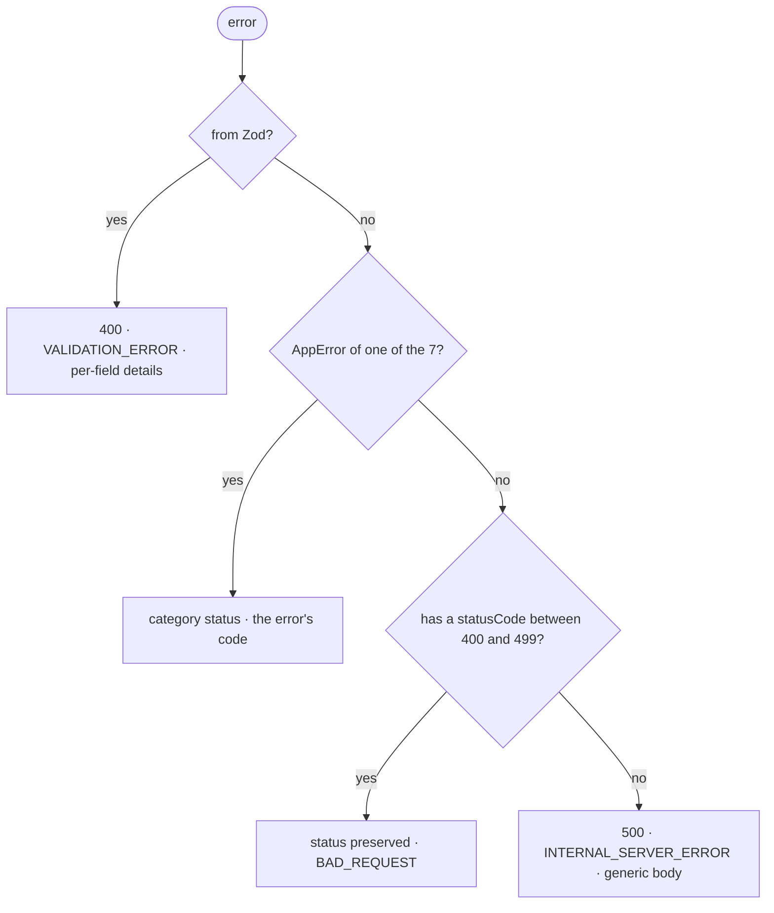

# Errors

A semantic taxonomy in the pure layer, a single translator to HTTP. The use case
throws, the endpoint does not handle it, the handler responds.

> **This is how to use it.** The reason behind each choice is in
> [`ARCHITECTURE.md`](../../../ARCHITECTURE.md) §8.

---

## The files

| file | layer | does |
|---|---|---|
| [`app-error.ts`](./app-error.ts) | pure | `AppError` + the 7 abstract categories |
| `src/modules/<m>/errors/*.ts` | pure | the module's concrete errors |
| [`error-handler.ts`](../../infra/http/errors/error-handler.ts) | infra | translates error → status + body |
| [`error-response.ts`](../../infra/http/errors/error-response.ts) | infra | Zod schema of the error body |
| [`validation-issues.ts`](../../infra/http/errors/validation-issues.ts) | infra | Zod issue → the contract's `code` |

A concrete error lives where it is thrown: a domain error in
`src/modules/<m>/errors/`; an error from a shared infra piece, in that piece's own
file — `InvalidAccessTokenError` is declared inside
[`auth-guard.ts`](../../infra/http/auth-guard.ts), because the guard is what
throws it, not a module. `src/shared/errors/` holds only the abstract categories:
no concrete error goes in here.

---

## How to use

**1. Create the error in your module**

```ts
// src/modules/auth/errors/invalid-credentials-error.ts
import { UnauthorizedError } from '#shared/errors/app-error'

const INVALID_CREDENTIALS_CODE = 'INVALID_CREDENTIALS'
const INVALID_CREDENTIALS_MESSAGE = 'Invalid credentials'

export class InvalidCredentialsError extends UnauthorizedError {
  readonly code = INVALID_CREDENTIALS_CODE

  constructor() {
    super(INVALID_CREDENTIALS_MESSAGE)
  }
}
```

The `code` is written by hand, never derived from the class name: renaming the
class must not change the public contract. The literal sits in a named constant
like every literal in the project, and the message is in English (`CLAUDE.md`).

**2. Throw it in the use case**

```ts
if (!user) throw new InvalidCredentialsError()
```

**3. Do not handle it in the endpoint**

```ts
async (request, reply) => {
  const { accessToken } = await container.loginUser.execute(request.body)

  return reply.status(OK_STATUS).send({ accessToken })
}
```

It comes out as `401` with `{"error":{"code":"INVALID_CREDENTIALS", ...}}`: no
`try/catch`, no failure status decided here.

**4. Declare the status in the route's schema**

```ts
response: {
  [OK_STATUS]: okSchema,
  [BAD_REQUEST_STATUS]: errorResponseSchema,   // Zod validation
  [UNAUTHORIZED_STATUS]: errorResponseSchema,  // InvalidCredentialsError
},
```

It is the only line of HTTP the error costs, and it is not optional: not handling
is not the same as not documenting. The OpenAPI is the contract the client
generates code from, and the cut is what **that route** produces — the generic
handler's `500` and the content-type `415` are universal and are not repeated in
every file ([`ARCHITECTURE.md`](../../../ARCHITECTURE.md) §7).

---

## Which category to choose

The question is "what kind of failure is this", not "what status do I want". The
status comes along with it.

| category | use when | status |
|---|---|---|
| `NotFoundError` | the requested resource does not exist | `404` |
| `ConflictError` | the current state collides with the operation | `409` |
| `UnauthorizedError` | not authenticated, or an invalid credential | `401` |
| `ForbiddenError` | authenticated, but without permission | `403` |
| `ValidationError` | the **value** is invalid by a domain rule | `400` |
| `BusinessRuleError` | the value is valid, the **operation** is not allowed | `422` |
| `TransientError` | a temporary failure that retrying may fix | `503` + `Retry-After` |

The two common mix-ups:

- **`401` vs `403`** — if the user logs in again and the error goes away, it is
  `401`; if it persists, it is `403`.
- **`Validation` vs `BusinessRule`** — `"abc"` is not a valid tax ID number:
  `ValidationError`. A balance of 10 is valid, withdrawing 50 from it is not:
  `BusinessRuleError`.

`ValidationError` is **domain** validation, thrown by a value object or a use
case. An invalid payload in the request body is caught by Zod before your code
runs and has a branch of its own.

---

## Handler behavior



- **The order carries meaning.** A Fastify validation error carries
  `statusCode: 400`; if the 4xx branch came first, it would swallow `details[]`.
- **The 500 branch leaks nothing** — a fixed message, no stack and no driver text.
  The full error goes to the log, correlated by the `traceId`.
- **An `AppError` outside the seven categories falls into the 500**, on purpose: it
  is a programming error, not a client problem.
- **A nonexistent route** answers `404 ROUTE_NOT_FOUND`, in the same format.

---

## The response

```jsonc
{
  "error": {
    "code": "INVALID_CREDENTIALS",
    "message": "Invalid credentials",
    "traceId": "6eedbea3-43fd-4f2a-a41b-3a39336b0268"
  }
}
```

```jsonc
// validation gets per-field detail
{
  "error": {
    "code": "VALIDATION_ERROR",
    "message": "Invalid payload",
    "details": [
      { "field": "email",    "code": "INVALID_FORMAT" },
      { "field": "password", "code": "TOO_SMALL" }
    ],
    "traceId": "6eedbea3-43fd-4f2a-a41b-3a39336b0268"
  }
}
```

- **`code` is a contract**, stable, and works as an i18n key on the client.
- **`message` is not a contract** — it is for log and debug, and must not be shown
  raw in a translated app.
- **`traceId`** is the same value as in that request's log line.
- `field` is omitted when the problem is the whole body, not a single field.

---

## Rules

| ✅ | ❌ |
|---|---|
| `throw new InvalidCredentialsError()` | `return { error: 'invalid' }` |
| `readonly code = INVALID_CREDENTIALS_CODE` | `readonly code = 'INVALID_CREDENTIALS'` |
| a hand-written constant | a `code` derived from the class name |
| extend one of the seven categories | extend `AppError` directly |
| a concrete error where it is thrown | a new concrete error in `src/shared/errors/` |
| an endpoint without `try/catch` | `try/catch` translating an error into a status |
| `[UNAUTHORIZED_STATUS]: errorResponseSchema` on the route | a route that declares only the happy path |
| `import { X } from '#shared/errors/app-error'` | `import ... from '../../../shared/...'` |

**Never** add `statusCode` to a pure-layer error. It is the obvious shortcut, and
it is what this design exists to prevent.

---

## Tests

Do not test that `NotFoundError` becomes `404` — it is already covered in
[`error-handler.spec.ts`](../../infra/http/errors/error-handler.spec.ts), category
by category.

In the use case, check the type:

```ts
await expect(useCase.execute(input)).rejects.toBeInstanceOf(InvalidCredentialsError)
```

At the HTTP edge, check the contract — with a named constant in the spec itself,
never imported from the error, otherwise the test becomes a tautology:

```ts
const UNAUTHORIZED_STATUS = 401
const INVALID_CREDENTIALS_CODE = 'INVALID_CREDENTIALS'

expect(response.statusCode).toBe(UNAUTHORIZED_STATUS)
expect(response.json().error.code).toBe(INVALID_CREDENTIALS_CODE)
```

Endpoints are covered by the integration specs in `tests/integration/` (for
example `login.spec.ts`); the same pattern runs in
[`auth-guard.spec.ts`](../../infra/http/auth-guard.spec.ts), which pins `401` and
`INVALID_ACCESS_TOKEN` exactly this way.

<sub>The diagram is Mermaid: GitHub renders it natively; in VS Code it requires
the <i>Markdown Preview Mermaid Support</i> extension.</sub>
